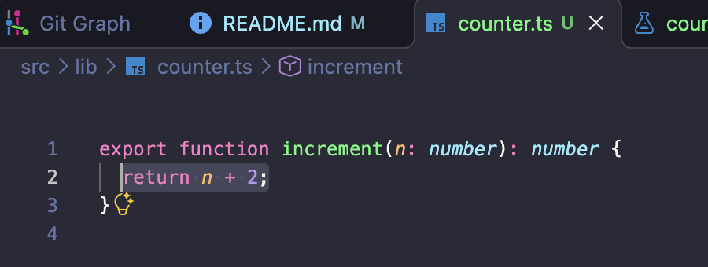
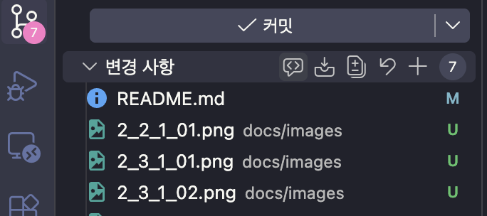
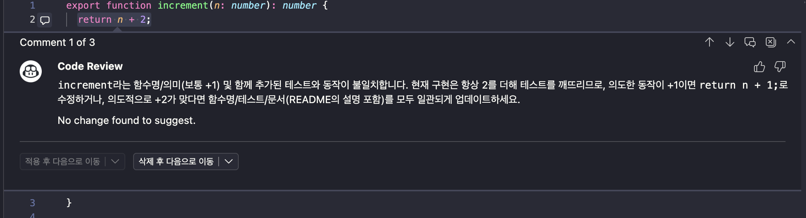
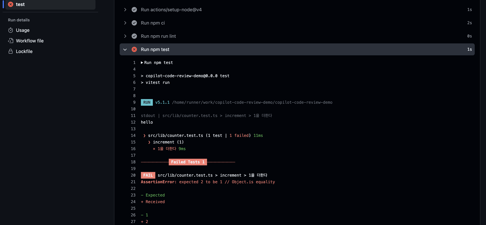
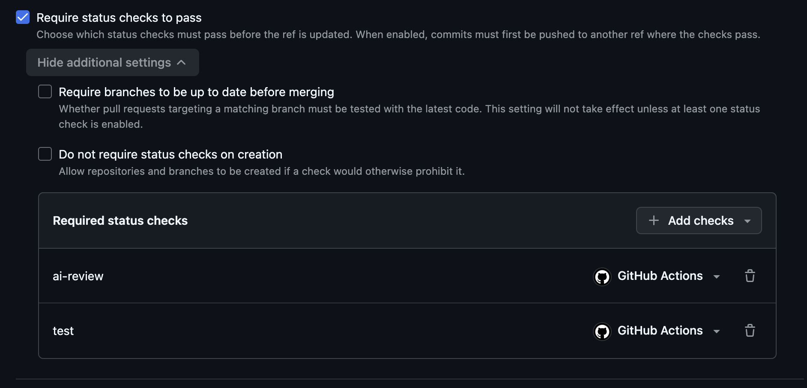
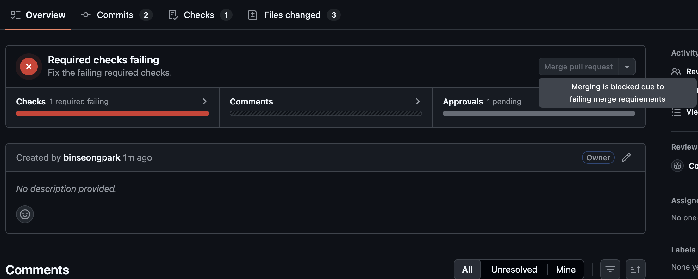

# Day 2 · Copilot / AI Review

---

## 2.2 GitHub Copilot Code Review

### 학습 목표

- PR에서 Copilot 리뷰를 수동/자동으로 받고 활용할 수 있다
- 팀 리뷰 기준을 Copilot에 주입할 수 있다
- Copilot 리뷰는 **조언**이지 승인이 아님을 이해한다

### 1. 코드 수정 해보기: 커밋 전 리뷰

> 🌿 브랜치: `feature/increment-step`

```ts
// src/lib/counter.ts
export function increment(n: number): number {
  return n + 1;
}
```

```ts
// src/lib/counter.test.ts
import { describe, it, expect } from "vitest";
import { increment } from "./counter";

describe("increment", () => {
  it("1을 더한다", () => {
    expect(increment(0)).toBe(1);
  });
});
```

```diff
// src/App.tsx
+import { increment } from './lib/counter'
 ...
         <button
           type="button"
           className="counter"
-          onClick={() => setCount((count) => count + 1)}
+          onClick={() => setCount((count) => increment(count))}
         >
```

- 커밋 전에 일부러 버그 심기

```diff
// src/lib/counter.ts
 export function increment(n: number): number {
-  return n + 1;
+  return n + 2;
 }
```



<!-- 📸 캡처: counter.ts를 n + 2로 수정한 diff -->

- Source Control → **변경 사항** 옆 리뷰 버튼 → 에디터에 인라인 코멘트
- ✨ 버튼으로 커밋 메시지 자동 생성
- 리뷰는 PR보다 **먼저, IDE에서** 시작할 수 있음




<!-- 📸 캡처: Source Control 패널의 Code Review 버튼 (말풍선 <> 아이콘) -->
<!-- 📸 캡처: 에디터 인라인 코멘트 "Comment 1 of N" 화면 -->

### 2. 수동 리뷰

> 🌿 브랜치: `feature/increment-step` (§1 변경을 그대로 커밋 → PR)

1. PR 생성 → Reviewers에서 `Copilot` 선택
2. 인라인 코멘트 확인
   - **Commit suggestion**: 제안 코드 바로 커밋
   - **Fix with Copilot**: 에이전트가 수정 커밋
3. 수정 후 **Re-request review**

<!-- 📸 캡처: Reviewers에서 Copilot 선택 -->
<!-- 📸 캡처: PR 개요 코멘트 (판정 + 요약) -->
<!-- 📸 캡처: 인라인 코멘트 + Suggested change -->

### 3. 자동 리뷰

> 🌿 브랜치: `chore/text-change` (Ruleset 켠 뒤 새 PR)

**Branch ruleset 만들기**

1. 레포 `Settings → Rules → Rulesets` → **New ruleset** → **New branch ruleset**
2. **Ruleset Name**: `main-protection` (자유)
3. **Enforcement status**: `Disabled` → **`Active`** 로 변경
4. **Target branches** → **Add target** → **Include default branch** (= `main`)
5. **Branch rules**
   - ✅ **Require a pull request before merging**: main 직접 push 금지, PR 필수
     - **Required approvals: `0`** (혼자 시연 → 본인 PR은 본인 승인 불가라 1 이상이면 머지 막힘)
   - ✅ **Automatically request Copilot code review**
     - ✅ **Review new pushes**: 새 커밋마다 자동 재리뷰
     - ⬜ Review draft pull requests: Draft PR도 리뷰 (선택)
   - 기본 체크된 **Restrict deletions / Block force pushes**는 그대로 둬도 됨
     - 단, 강의 후 `git reset --hard baseline` + force push 하려면 **Block force pushes 해제** 필요
6. 맨 아래 **Create** 클릭

- PR을 만들면 Copilot이 리뷰어로 자동 지정
- 자동 리뷰도 **PR 작성자 명의**로 실행 (비용도 작성자)
- Free 플랜은 **Public 레포**에서만 Ruleset 사용 가능

<!-- 📸 캡처: Ruleset의 Copilot code review 체크박스 -->
<!-- 📸 캡처: PR 타임라인 "Copilot started reviewing on behalf of ..." -->

### 4. 팀 기준 주입: `copilot-instructions.md`

> 🌿 브랜치: `chore/copilot-instructions`

```markdown
<!-- .github/copilot-instructions.md -->

## Code review guidelines

- 코멘트마다 심각도를 [High] / [Low]로 표시한다
- 로그에 개인정보(이메일, 전화번호)를 남기지 않는다
- 리뷰 코멘트는 한국어로 작성한다
```

| 파일                                     | 용도                                             |
| ---------------------------------------- | ------------------------------------------------ |
| `.github/copilot-instructions.md`        | 레포 전체 공통 규칙 (VS Code 리뷰도 이것만 읽음) |
| `.github/instructions/*.instructions.md` | 경로별 규칙 (`applyTo`)                          |
| `AGENTS.md`                              | 여러 AI 도구 공통                                |
| `REVIEW.md`                              | 웹 코드 리뷰 전용                                |

<!-- 📸 캡처: 지침 추가 전/후 리뷰 코멘트 비교 ([High]/[Low] 태그 유무) -->

### 5. Copilot 리뷰 = 조언

- 리뷰 타입은 **Comment** — "Approval recommended"가 떠도 승인 아님
- 머지를 **막지도, 통과시키지도 못함**
- 승인은 설정에서 켜야 가능 (Auto-approval, opt-in)

<!-- 📸 캡처: 버그 지적이 달렸는데도 머지 버튼이 초록색인 화면 -->

> 💬 AI가 1차 리뷰를 하면, 사람 리뷰어는 무엇에 집중해야 할까?

---

## 2.3 Copilot / AI review inside the pipeline

### 학습 목표

- CI를 **Required status checks**로 만들어 머지를 막을 수 있다
- Actions 안에서 AI를 **게이트**로 쓸 수 있다
- 실패를 **에이전트가 수정**하는 흐름을 이해한다

### 1. 큰 그림

```
PR open / push
  ├─ Copilot Code Review  → 조언       ── 머지 영향 ❌
  ├─ CI (test)            → 성공/실패  ── required면 차단 ✅
  └─ AI gate (ai-review)  → 성공/실패  ── required면 차단 ✅
        ↓ 실패
  Fix with Copilot / Agent merge → 수정 커밋 → 다시 파이프라인
```



- 머지를 막는 건 **리뷰가 아니라 체크(status)**

### 2. CI + Required status checks

> 🌿 브랜치: `ci/add-ci` (ci.yml 추가 → 머지) → `test/break-counter` (테스트 깨뜨려서 머지 차단 확인)

**① CI 워크플로 추가** (`ci/add-ci` → PR → `test` 통과 → 머지)

```yaml
# .github/workflows/ci.yml
name: CI
on:
  pull_request:

jobs:
  test:
    runs-on: ubuntu-latest
    steps:
      - uses: actions/checkout@v4
      - uses: actions/setup-node@v4
        with:
          node-version: 22
          cache: npm
      - run: npm ci
      - run: npm run lint
      - run: npm test
```

**② Ruleset에 필수 체크 등록**

- Ruleset → ✅ **Require status checks to pass** → **Add checks** → `test` 입력 후 선택
  - 하위 옵션(Require branches to be up to date / Do not require on creation)은 체크 안 함
- 체크 이름 = **job 이름**, 한 번 실행된 체크만 검색됨

**③ 테스트 깨뜨리기** (`test/break-counter` → PR)

```diff
// src/lib/counter.ts
 export function increment(n: number): number {
-  return n + 1;
+  return n + 2;
 }
```

- PR 열면 `test` 실행 → `expect(increment(0)).toBe(1)` 실패
- ❌ `test` → **머지 버튼 비활성화**




<!-- 📸 캡처: Ruleset Add checks에 test, ai-review 추가된 화면 -->
<!-- 📸 캡처: test 실패 → 머지 버튼 비활성화 -->

### 3. AI를 게이트로: Actions + Copilot CLI (`actions/ai-inference@v3`)

> 🌿 브랜치: `ci/ai-review-gate` (워크플로 추가, PASS 확인) → `feature/greeting` (XSS, BLOCK 확인)

- 사전 준비: Fine-grained PAT(**Copilot Requests** 권한) → 레포 Secret `COPILOT_PAT`
- 비용은 **PAT 주인의 Copilot 크레딧**

```yaml
# .github/workflows/ai-review-gate.yml
name: AI Review Gate
on:
  pull_request:

permissions:
  contents: read

jobs:
  ai-review:
    runs-on: ubuntu-latest
    steps:
      - uses: actions/checkout@v4
        with:
          fetch-depth: 0
      - uses: actions/setup-node@v4
        with:
          node-version: 22
      - run: npm install -g @github/copilot

      - name: Build prompt
        run: |
          {
            echo "다음 git diff를 리뷰해줘."
            echo "하드코딩된 시크릿이나 XSS 같은 명백한 보안 문제가 있으면"
            echo "먼저 이유를 한국어로 짧게 설명한 뒤,"
            echo "마지막 줄에는 정확히 BLOCK 또는 PASS 한 단어만 써."
            echo
            git diff origin/${{ github.base_ref }}...HEAD
          } > prompt.txt

      - name: AI review
        id: ai
        uses: actions/ai-inference@v3
        with:
          model: ""
          prompt-file: prompt.txt
          system-prompt: You are a strict security code reviewer.
        env:
          COPILOT_GITHUB_TOKEN: ${{ secrets.COPILOT_PAT }}

      - name: Gate
        env:
          RESULT: ${{ steps.ai.outputs.response }}
        run: |
          echo "$RESULT"
          LAST="$(printf '%s\n' "$RESULT" | grep -v '^[[:space:]]*$' | tail -n1)"
          if [[ "$LAST" != "PASS" ]]; then
            echo "::error::AI review blocked this PR"
            exit 1
          fi
```

- 마지막 줄이 정확히 **PASS일 때만 통과** (fail-closed)
- 왜 마지막 줄? 모델은 앞에서부터 생성 → 판정을 먼저 쓰게 하면 **생각하기 전에 결론**
  - 실제 사례: 첫 줄 `BLOCK` → 설명하다가 "정정: PASS" → Gate는 첫 줄만 봐서 실패

<!-- 📸 캡처: 첫 줄 BLOCK 후 "최종 판정: PASS"로 번복한 Gate 로그 -->

- `ai-review`도 Required status checks에 등록

**BLOCK 예제: 겉보기엔 멀쩡한 XSS**

> 🌿 브랜치: `feature/greeting` (`ci/ai-review-gate` 머지 후 main에서 새로 생성)

```tsx
// src/components/Greeting.tsx
export function Greeting() {
  // URL의 name을 받아 인사말 표시
  const name = new URLSearchParams(location.search).get("name") ?? "손님";
  return <h1 dangerouslySetInnerHTML={{ __html: `안녕하세요, ${name}님` }} />;
}
```

```diff
// src/App.tsx
+import { Greeting } from './components/Greeting'
 ...
         <div>
-          <h1>Get started</h1>
+          <Greeting />
           <p>
```

```
http://localhost:5173/?name=
```

- lint·test는 통과 → AI 게이트가 BLOCK
- 수정: `<h1>안녕하세요, {name}님</h1>` (React가 자동 이스케이프)

<!-- 📸 캡처: 브라우저에 alert('XSS!') 창이 뜬 화면 -->
<!-- 📸 캡처: test ✅ / ai-review ❌ + 머지 차단 -->
<!-- 📸 캡처: Actions 로그의 BLOCK 판정과 한국어 설명 -->

### 4. 실패 대응 자동화: 에이전트가 고친다

> 🌿 브랜치: `feature/greeting` (BLOCK된 PR을 그대로 수정)

- **Fix with Copilot**: 코멘트에서 버튼 한 번 → 에이전트가 수정 커밋
- **Agent merge** (Copilot 앱): 리뷰 반영 / CI 수정 / 충돌 해결을 반복
  - 위치: PR 세션 → **Ready to merge ▾** 드롭다운 → **Agent merge** 토글
  - Allow the agent to: Address reviews ✅ · Fix CI failures ✅ · Resolve conflicts ✅ · **Merge pull request ☐**
  - **머지는 기본 해제(opt-in)** — 체크해야 머지까지 수행
  - 켜도 ruleset(required checks·승인 조건)은 **우회 못 함** → 게이트 통과해야 머지
- 수정 커밋 → 자동 재리뷰 → CI 재실행 → 통과 시 머지

<!-- 📸 캡처: Fix with Copilot 버튼 -->
<!-- 📸 캡처: Agent merge 옵션 창 (Ready to merge ▾ 드롭다운, Merge pull request 해제 상태) -->
<!-- 📸 캡처: 수정 후 체크 전부 ✅ -->

### 5. 어디까지 맡길까

| 단계 | 기본값           | 켜면                 |
| ---- | ---------------- | -------------------- |
| 리뷰 | 코멘트           | 승인까지             |
| 수정 | 사람이 버튼 클릭 | 에이전트가 자동 반영 |
| 머지 | 사람             | 에이전트가 머지      |

- 결정론적 도구(테스트, 린터, CodeQL)를 **대체가 아니라 보완**
- AI 판단은 매번 다를 수 있음 → 게이트 조건은 좁고 명확하게

> 🎯 **AI는 리뷰어(조언)이자 체크(게이트). 승인·머지까지 맡길지는 사람이 정한다.**

---

## 참고 링크

- Copilot code review: https://docs.github.com/en/copilot/using-github-copilot/code-review/using-copilot-code-review
- 자동 리뷰 설정: https://docs.github.com/en/copilot/how-tos/use-copilot-agents/request-a-code-review/configure-automatic-review
- 지침 파일 지원 표: https://docs.github.com/en/copilot/reference/custom-instructions-support
- actions/ai-inference: https://github.com/actions/ai-inference
